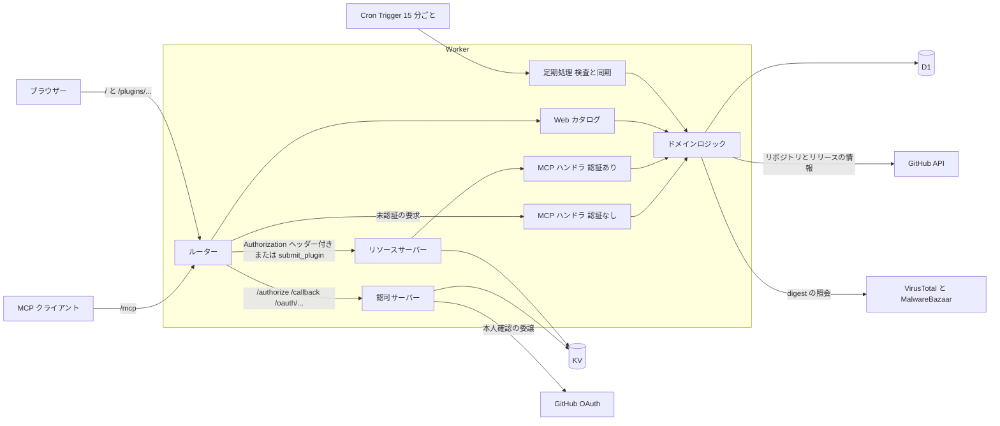

# アーキテクチャ

配信プラグイン倉庫くんの構成要素と、要求の流れを説明します。各要素の詳細は、本文中で示す設計文書に記載します。

## 全体像

本サービスは、Cloudflare Workers 上の 1 つの Worker で動きます。Worker は、MCP エンドポイント・OAuth の認可サーバー・Web カタログ・定期処理を兼ねます。永続データは D1 に置き、OAuth の状態は KV に置きます。プラグインの概要の機械翻訳には Workers AI を使います。

単一の Worker にまとめるのは、構成要素と運用の手間を最小にするためです。MCP と Web は共通のドメインロジックを使います。そのため、検索の条件や掲載状態の算出が経路によって食い違うことはありません。ホスティング基盤の判断は [ADR 0001](../decisions/0001-hosting-cloudflare-workers-free.md) に記載しています。

本サービスは、プラグインの情報の正を GitHub に置きます。D1 が保持するのは、GitHub から取得した情報の写しと、本サービス固有の情報です。固有の情報は、検査結果・管理停止・登録の記録・レート制限の記録・概要の機械翻訳・ロゴと説明の画像・ダウンロード数の日ごとの記録です。配布物のファイルは保持せず、利用者は GitHub から直接ダウンロードします。

## 要求の流れ

ルーターは、OAuth のメタデータを除く要求について、振り分ける前に送信元 IP アドレスごとのレート制限を確かめます。上限は経路ごとに異なり、[認証と認可](auth.md) に記載します。

### 検索と詳細取得

MCP クライアントは、`/mcp` へ `search_plugins` または `get_plugin` を送ります。ルーターは、`Authorization` ヘッダーの無い要求を認証なしの MCP ハンドラへ渡します。ハンドラは D1 から情報を読み、掲載状態を算出して応答します。

ブラウザーからの要求も、同じドメインロジックを通ります。Web カタログは閲覧専用で、HTML を返すだけです。

### 登録

`submit_plugin` の呼び出しは、ルーターがリソースサーバーへ渡します。アクセストークンを持たない要求には 401 を返し、MCP クライアントにサインインを促します。サインインの流れは [認証と認可](auth.md) に記載します。

検証を通ったトークンの要求は、認証ありの MCP ハンドラが処理します。ドメインロジックは GitHub API で管理権限とリポジトリの情報を確かめ、D1 に保存します。保存した直後のプラグインは検査待ちです。1 つの Worker で認証混在にする判断は [ADR 0002](../decisions/0002-single-worker-mixed-auth.md) に記載しています。

### 検査と同期

Cron Trigger は 15 分ごとに Worker の定期処理を起動します。定期処理は、検査待ちの `digest` をスキャナーへ照会し、残りの予算で登録済みのプラグインの同期・ダウンロード数の記録・概要の機械翻訳を行います。検査を登録時に行わず定期処理で進める理由は [ADR 0007](../decisions/0007-asynchronous-scanning-with-cron.md) に記載しています。予算と処理の順序は [検査と同期](scanning.md) に記載します。

## 外部データの扱い

GitHub から取得した文字列は、外部データとして扱います。MCP の応答では外部データを専用のフィールドに入れ、ツールの説明で指示として扱わないことを明記します。Web では、テンプレートの自動エスケープで無害化します。

ドメインロジックは、外部への要求を `api.github.com`・`www.virustotal.com`・`mb-api.abuse.ch` の固定のホストにだけ送ります。利用者が入力した URL からは owner と repo だけを取り出し、その URL へは要求を送りません。これにより、SSRF を防ぎます。

例外は、認可サーバーが取得する CIMD の文書です。CIMD の文書の URL は MCP クライアントが指定します。Worker の互換性フラグ `global_fetch_strictly_public` を有効にし、公開されたインターネット上のホストにだけ要求を送るようにしています。

本サービスは、プラグインのインストールやコマンドの実行の機能を持ちません。

## 関連文書

- [データモデル](data-model.md)
- [認証と認可](auth.md)
- [検査と同期](scanning.md)
- [多言語対応](i18n.md)
- [画面構成](ui.md)
